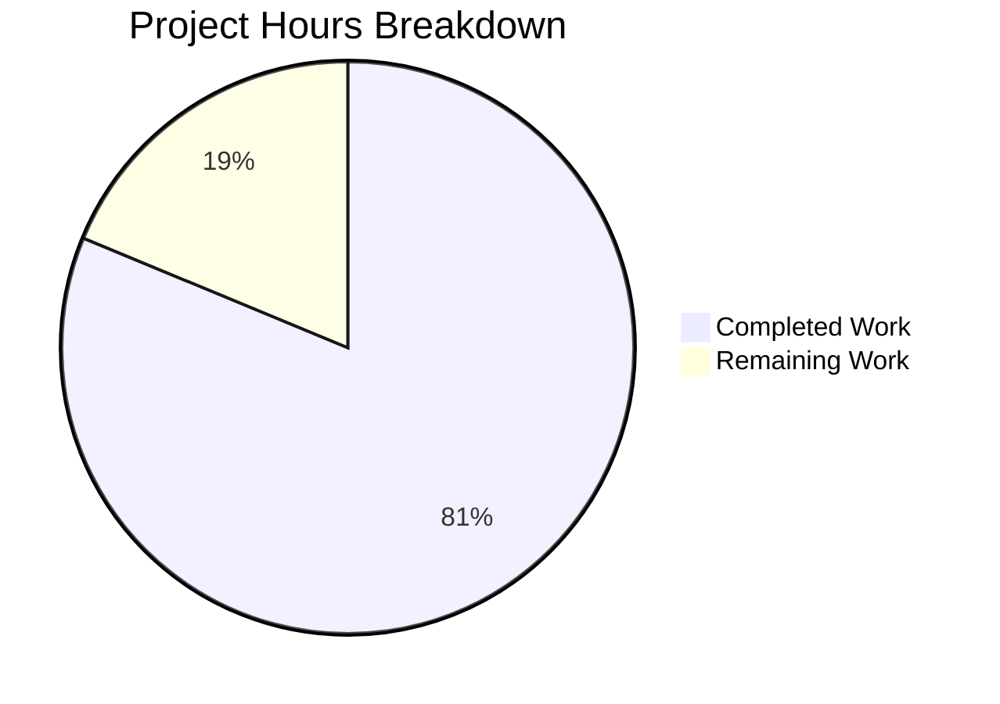
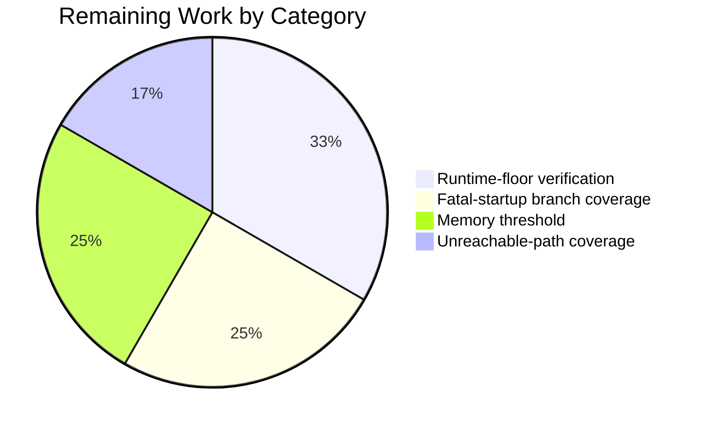

# 1. Executive Summary

## 1.1 Project Overview

`nodejs-tutorial-hello-world` is a single-file, zero-dependency Node.js HTTP server and a reference implementation for developers learning how Node.js handles HTTP. It serves one route — `GET /hello` answers 200 with `Content-Type: text/plain` and the body `Hello world` — and a catch-all 404 for every other path and method. Around that core sit one query-free console line per request, a validated `PORT`, a startup line printed once the port is bound, a graceful `SIGINT` shutdown that exits 0 with idle keep-alive connections open, and fatal-startup messages that exit non-zero without a stack trace. `server.js` is the whole application; `README.md` documents it and `package.json` declares it. There is no framework, dependency or build step.

## 1.2 Completion Status

Measured against the planned scope: the three delivered files and the path to production. **81% complete — 26 of 32 hours delivered.**



| Metric | Hours |
| --- | --- |
| Total Hours | 32 |
| Completed Hours (AI + Manual) | 26 |
| Remaining Hours | 6 |
| Completion | 81% |

## 1.3 Key Accomplishments

- **The route and the catch-all** — `GET /hello` returns 200 with `Content-Type: text/plain` and `Hello world`; every other path or method returns 404 `Not Found`.
- **One request line per request** — 3,202 requests, 3,202 query-free lines, written before routing.
- **Configuration that fails fast** — default 3000, digits-only 1024–65535, 14 invalid values each exiting 1 with nothing bound.
- **A complete lifecycle** — one startup line after the bind on both commands; `SIGINT` exits 0 with an idle keep-alive client on both shutdown branches.
- **Failures contained, performance proven** — stack-free `EADDRINUSE`, a generic 500 for forced errors, 101 timed requests under 10 ms (max 1.71 ms), 100 concurrent answered.
- **Documentation and hygiene** — manifest exact, documented outputs matching reality, no dead code or line over 80 columns.

## 1.4 Critical Unresolved Issues

Five items remain open; none blocks release — two caveats on acceptance criteria, leaving 14 of 16 closed with no caveat, and three built paths no check can reach.

| Issue | Impact | Owner | ETA |
| --- | --- | --- | --- |
| Node 18.0.0 and 18.1.0 are never exercised natively; the pre-18.2.0 fallback is reached only with the capability check forced | The declared runtime floor and its one differing shutdown path are unproven on a real 18.0/18.1 runtime | Maintainer | 2 h |
| The sustained-load clause states no threshold, so memory stands as an observation | Resident size cannot pass or fail against a stated bound | Maintainer | 1.5 h |
| The `EACCES` fatal-startup message has no reachable trigger through `PORT` | A branch an operator may meet is unexercised | Maintainer | 1.5 h |
| The `U+007F` row of the invalid-`PORT` escape is unexercised (the CR/LF rows are covered) | One row of the message-hardening behaviour is unproven | Maintainer | 0.5 h |
| The request-error `'unknown request'` fallback is unreachable from a real client | A defensive branch has no observed behaviour | Maintainer | 0.5 h |

## 1.5 Access Issues

No access issues identified: no credential or secret is required, only read access, and no external service is called.

## 1.6 Recommended Next Steps

1. [High] Run the full behaviour matrix on a real Node 18.0.0 and 18.1.0 runtime, to close the declared floor.
2. [Medium] Force `EACCES` and a code-less listen failure; confirm one clear line, exit 1, no stack.
3. [Medium] Set a maximum resident-size growth for the sustained-load clause and re-measure.
4. [Low] Trigger the `U+007F` escape row and the request-error fallback and record their output.
5. [Low] Decide whether to fold the body comment at `server.js:192` and `SHUTDOWN_GRACE_MS` into the specification's enumerations.

# 2. Project Hours Breakdown

## 2.1 Completed Work Detail

| Component | Hours | Description |
| --- | --- | --- |
| `server.js` — request pipeline, routing and response contract | 6.0 | One derived path feeds both the logger and the router; `GET /hello` answers `200` with `Content-Type: text/plain` and the body `Hello world` in a single response step, and every other method or path is answered by the catch-all `404 Not Found`. Covers F1–F4 and F13. |
| `server.js` — `PORT` validation, startup line and fatal-startup paths | 4.0 | `readPort` with the digits-only 1024–65535 rule and the escaped, range-naming rejection message; the single startup line emitted on the `listening` event; actionable `EADDRINUSE`, clear `EACCES` and generic fatal messages, each exiting with status 1 and no stack dump. Covers F6, F7, F9 and NF5. |
| `server.js` — graceful `SIGINT` shutdown and connection bookkeeping | 4.0 | One shutdown line, `server.close()` before any socket is closed, the capability-guarded idle-connection close with the tracked-socket fallback for runtimes before 18.2.0, and the unref'd two-second safety timer that bounds a socket refusing to close. Covers F8 and NF4. |
| `server.js` — unexpected-request-error containment | 2.0 | The single `try`/`catch` around the pipeline, the query-free error line naming the request and the error message, the `res.headersSent` guard, and the destroy branch that avoids writing a second response. Covers F10 and NF3. |
| `package.json` — manifest and entry contract | 1.0 | The seven declared fields with their exact values and no dependency key of any kind, giving `npm start` its `node server.js` command and the project its Node.js `>=18.0.0` floor. Covers F11. |
| `README.md` — documentation and output fidelity | 3.0 | Purpose, prerequisites, installation, running, testing, stopping and configuration, with every command and console block checked against the running server. Covers F12 and NF7. |
| Acceptance verification | 6.0 | The sixteen acceptance criteria with their negative checks: the response and near-miss matrix, the request-line count, the invalid-`PORT` matrix, the occupied-port row, the shutdown matrix including the fallback branch, the timed and concurrent runs, the sustained-load sampling and the forced-error probes. Covers NF1, NF2, criterion 6 and the negative checks of criteria 10, 11 and 13. |
| **Total** | **26.0** | |

## 2.2 Remaining Work Detail

| Category | Hours | Priority |
| --- | --- | --- |
| Runtime-floor verification on a real Node 18.0.0 and 18.1.0 runtime — the declared portability floor, whose one differing path is the tracked-socket shutdown fallback | 2.0 | High |
| Fatal-startup branch coverage beyond `EADDRINUSE` — forcing `EACCES` and a listen failure carrying no error code | 1.5 | Medium |
| A stated threshold for the sustained-load memory clause, and the re-measurement against it | 1.5 | Medium |
| Coverage of the remaining unreachable paths — the `U+007F` escape row of the invalid-`PORT` message and the request-error fallback | 1.0 | Low |
| **Total** | **6.0** | |

# 3. Test Results

The project ships no automated test suite by design, so verification is the scripted `curl`/shell acceptance set the specification fixes: the sixteen acceptance criteria and their negative checks, executed against the running server. The table below groups the 181 assertions that were executed and observed. All 181 passed; no assertion failed. Nothing is instrumented for line coverage, because no test framework or coverage tooling is part of the product.

| Area / Category | Framework | Tests | Passed | Failed | Coverage | What This Proves |
| --- | --- | --- | --- | --- | --- | --- |
| Startup and both documented entry points | `curl` + shell | 9 | 9 | 0 | n/a — no instrumentation ships | `node server.js` and `npm start` both bind the port and print exactly one startup line with nothing before it, the resolved port is reported, and each exits 0 on interruption |
| Route, catch-all and matching semantics | `curl` + shell, raw sockets for fragment targets | 25 | 25 | 0 | n/a | The single route returns the exact status, header and body, and every near miss — case, trailing slash, dot segments, percent-encoding, fragments, non-GET methods — is answered by the catch-all |
| Request logging | `curl` + shell | 5 | 5 | 0 | n/a | Every request writes exactly one line in the fixed format, before routing, with the query string absent; 3,202 requests produced 3,202 lines and nothing else |
| `PORT` configuration and validation | shell | 75 | 75 | 0 | n/a | The default, both boundaries and leading zeros are accepted; 14 invalid values each exit 1 with one range-naming line, no startup line and no bound port |
| Fatal startup paths and graceful shutdown | shell, `kill -INT`, keep-alive client | 15 | 15 | 0 | n/a | A second instance on an occupied port fails cleanly while the first keeps serving, and interruption exits 0 with idle keep-alive connections open on both shutdown branches |
| Runtime performance and stability | `--require` timing preload, `curl`, `/proc/<pid>/status` | 8 | 8 | 0 | n/a | Server-side latency stays far below the 10 ms criterion, 100 concurrent requests all succeed, and resident size stays in a narrow decelerating band under sustained load |
| Error containment and internal-detail leakage | shell with instrumented copies outside the tree | 21 | 21 | 0 | n/a | A forced request error returns a generic 500 with nothing internal in body or header, and an error after the headers destroys the response instead of writing a second one |
| Manifest, documentation fidelity and code quality | `node -e`, `diff`, file inspection | 23 | 23 | 0 | n/a | The manifest's seven fields and absent dependency key, every documented command and output, and the source's quality standards all match the specification |

**Not Covered**

The following could not be exercised and are what a maintainer should test before release:

- **The pre-18.2.0 shutdown fallback on a real Node 18.0.0 or 18.1.0 runtime.** The branch (`server.js:193-201`) was exercised by forcing the capability check false on an instrumented copy outside the repository; the host provides Node v22.23.3 only, so the declared floor itself has never been run.
- **The `EACCES` fatal-startup message and the code-less generic fatal message** (`server.js:164-173`). Both are present and stack-free by reading, but `PORT` validation rejects privileged ports before any listen call, so neither is reachable through the configuration input.
- **The request-error `'unknown request'` fallback** (`server.js:90`). It needs a request object without a `url`, which a real client cannot produce.
- **The `U+007F` row of the invalid-`PORT` control-character escape** (`server.js:28-31`). The carriage-return and line-feed rows are covered; this row is not.
- **The sustained-load memory clause as a pass or fail.** The specification states no threshold, so resident-size samples are an observation; state a maximum growth and re-measure.
- **Anything the product does not have by design:** no HTTPS/TLS, authentication, authorization, CORS, rate limiting, request-body or query parsing, persistence, static file serving, outbound calls, additional endpoints, container or pipeline surface exists to test.
- **No automated regression guard exists at all**, by design: the fixed literals (`Content-Type: text/plain`, `Hello world`, `Not Found`, the startup line, the exit statuses) are protected only by review, so a future edit to any of them would not be caught by a suite. A one-file check script outside the delivered tree is the natural guard if you want one.

# 4. Runtime Validation &amp; UI Verification

- ✅ **Start-up, `node server.js`** — one `Server listening on port <PORT>` line, zero bytes on standard error, nothing printed before the port is bound, and the port accepting as soon as the line appears.
- ✅ **Start-up, `npm start`** — npm's four-line banner precedes the server's own line; the overridden port serves 200; interrupting the run leaves npm's own status 130 exactly as the README documents.
- ✅ **Primary flow, `GET /hello`** — 200 with the header exactly `Content-Type: text/plain` (no charset) and the body `Hello world` byte-exact, over HTTP/1.1 and HTTP/1.0.
- ✅ **Matching flow** — `/hello?x=1` and `/hello?` return 200; `/hello/`, `/Hello`, `/HELLO`, `/hell`, `/helloo`, `/hello.`, `/`, `/hello/../hello`, `/%68ello`, `//hello`, `POST /hello`, `HEAD /hello` and a raw `/hello#frag` target all return 404 `Not Found`.
- ✅ **Logging flow** — one line per request in the fixed `[<ISO-8601 timestamp>] [<METHOD>] [<path>]` form, written before routing, with no query string on any line: 3,202 requests produced 3,202 lines and nothing else on either stream.
- ✅ **Configuration flow** — `PORT` unset resolves to the documented 3000, `1024` and `65535` are accepted, `03000` is accepted as 3000, and 14 invalid values each exit 1 with one range-naming line and no bound port.
- ✅ **Failure flow** — a second instance on the occupied port exits 1 with an actionable message naming the port and an example `PORT=`, prints no stack frame, and leaves the first instance serving 200; a forced error before the headers returns exactly 500 `text/plain` `Internal Server Error` with nothing internal in the body or headers.
- ✅ **Failure flow, after the headers** — a forced error once the response has begun destroys the connection instead of writing a second response: the client sees an empty reply, one plain error line is logged, and the process keeps serving.
- ✅ **Shutdown flow** — `SIGINT` with a genuinely idle keep-alive connection open prints one `Server shutting down` line, exits with status 0 and releases the port; two pipelined requests are both answered in full before the shutdown completes.
- ⚠ **Runtime portability** — the pre-18.2.0 tracked-socket branch was exercised with the capability check forced, giving the same exit 0; the declared Node 18.0.0 and 18.1.0 runtime itself was never exercised, so every measurement above comes from Node v22.23.3.

**What was never exercised, and why.** The product has no user interface: every response is `text/plain` with no HTML, stylesheet, script, template or asset, so there is no screen, form, rendered flow or front-end asset to drive, and no browser-level verification applies. It also has no external integration: the server never acts as a client, consumes no external API contract, holds no credential, secret or environment value beyond the optional `PORT`, and depends on no database, cache, broker or third-party service — the only host resource it uses is one TCP port. Beyond the interface itself, the paths listed as *Not Covered* in Section 3 are the runtime behaviours that were never driven: the `EACCES` and code-less fatal-startup messages, the `'unknown request'` error-line fallback, the `U+007F` escape row, and the shutdown fallback on a real Node 18.0.0 or 18.1.0 runtime.

# 5. Compliance &amp; Quality Review

## 5.1 Compliance Matrix

| Deliverable | Requirement | Status | Progress | Verified by |
| --- | --- | --- | --- | --- |
| `server.js` | F1 — one HTTP server in a single CommonJS file, `http` the only import | ✅ Pass | 100% | `server.js:1-3`, `135`; one `require` call in the file |
| `server.js` | F2 — `GET /hello` answers 200, `Content-Type: text/plain`, body `Hello world` | ✅ Pass | 100% | `server.js:67-69`, `78-81`; observed 200 and byte-exact body |
| `server.js` | F3 — catch-all 404 for every other path and every other method | ✅ Pass | 100% | `server.js:72-74`, `83`; 12 near-miss targets observed 404 |
| `server.js` | F4 — pathname-only, case-sensitive, exact matching with the query discarded | ✅ Pass | 100% | `server.js:42-52`; `/hello?x=1` 200, `/hello/` and `/Hello` 404 |
| `server.js` | F5 — exactly one request log line, written before routing | ✅ Pass | 100% | `server.js:55-57`, `126-127`; 3,202 requests, 3,202 query-free lines |
| `server.js` | F6 — `PORT` read from the environment with fail-fast validation | ✅ Pass | 100% | `server.js:14-39`, `210-218`; 14 invalid values, all exit 1 with nothing bound |
| `server.js` | F7 — exactly one startup line, printed once the port is bound | ✅ Pass | 100% | `server.js:150-152`; one line per instance, nothing printed earlier |
| `server.js` | F8 — graceful `SIGINT` shutdown, exiting 0 with idle keep-alive connections open | ✅ Pass | 100% exercised branches | `server.js:182-206`, `224`; exit 0 on the modern and forced-fallback branches |
| `server.js` | F9 — actionable `EADDRINUSE`, clear `EACCES` and other fatal messages, no stack dump | ⚠ Pass, two rows unreachable | 100% implemented, `EADDRINUSE` exercised | `server.js:156-176`; occupied-port row observed exit 1 with zero `at ` frames |
| `server.js` | F10 — unexpected request errors contained, generic response, no internal detail | ✅ Pass | 100% | `server.js:87-110`; forced errors before and after the headers |
| `package.json`, `README.md` | F11, F12, NF7 — exact manifest, seven documented topics, documented output matching reality | ✅ Pass | 100% | `package.json` seven keys, no dependency key; every README command re-run |
| `server.js` | F13, NF1–NF6 — structure, quality, security boundaries, latency, concurrency, exit statuses | ✅ Pass | 100% | 13 named functions; 101 timed requests, 3,202 under 10 ms; no internal detail in any response |

## 5.2 AAP &amp; Rule Divergences and Gaps

| # | What the Specification or Rule Required | What Was Delivered Instead | Why It Diverged | Impact | Remediation |
| --- | --- | --- | --- | --- | --- |
| 1 | `README.md` created as a new file, like the other two deliverables | The README is an update of the 49-byte placeholder already tracked at that path | The path already existed on disk as a tracked placeholder; delivering the README means writing that file, and no second documentation file was added | None — the README at that path is the delivered documentation | Nothing |
| 2 | The per-socket mark described as a boolean "busy" flag | A per-socket count of in-flight requests (`server.js:117`, `119`, `197`) | A boolean cannot express two pipelined requests on one keep-alive socket | Stronger than specified: the shutdown fallback spares a socket that still owes a response | Nothing; if the shorthand is normative, the wording is what changes |
| 3 | Body comments reserved for four enumerated mechanisms | A fifth body comment at `server.js:192` on why the listener precedes the bind | The ordering reason cannot be inferred from the code, and the enumeration reads as an inventory rather than a cap | None | Optional: fold the sentence into the `main` responsibility comment |
| 4 | Three port constants (`DEFAULT_PORT`, `MIN_PORT`, `MAX_PORT`) | Those three plus a named `SHUTDOWN_GRACE_MS = 2000` (`server.js:11`) | Gives the two-second safety-timer literal a name instead of inlining it; no behaviour or component is added | None | Optional: inline the literal if the component list must be exact |
| 5 | Actionable `EADDRINUSE` message suggesting another port, with `PORT=3001` as the example | The suggestion is `port + 1`, clamped to `MIN_PORT` at `MAX_PORT` (`server.js:157-163`) | The fixed content is "actionable and naming `PORT`"; the clamp never suggests a port outside the accepted range | At the very top of the range the suggestion is conservative (1024) rather than adjacent | Nothing; adjust only if an adjacent suggestion is preferred at the boundary |
| 6 | The error line names the request, from a handler fixed at `(err, res)` | The request is named through `res.req.url`, cut at its first `?` (`server.js:90-97`), not re-derived through `getRequestPath` | Re-running the derivation that may itself have thrown is unsafe, and the fixed signature admits no other request handle | None — the line stays query-free and the client still receives the generic 500 | Nothing |
| 7 | The request hot path described as carrying no per-request timers or closures | One `res.on('finish', …)` closure is registered per request (`server.js:118-120`) | The shutdown contract requires the in-flight mark to be cleared when the response finishes, which needs exactly that listener | None measurable — 101 timed requests all under 10 ms | Nothing |
| 8 | Verification on the documented ports, and the documented `npm install` step run | Verification ran on a partitioned port block, the installer was not run, and no browser validation was performed | One host port range is shared by many concurrent checkouts, so the literals cannot be bound; `npm install` would create the lockfile the delivery excludes; every response is `text/plain` with no browser surface | Verification method only — no delivered byte or documented value differs | Nothing |

**1 — the README at a path that was already occupied.** The plan maps all three deliverables as new files because the repository was expected to start empty. In practice `README.md` existed as a tracked 49-byte placeholder, so the delivered file is an update of that path rather than a fresh creation. Nothing was renamed, moved, or duplicated, and no second documentation file was added: the file a reader opens at the repository root is the tutorial documentation described in Sections 1.1 and 9. The only practical consequence is for anyone diffing the branch against its base, who will see two deletions where they might have expected none.

**2 — a count where the plan describes a flag.** The plan calls the per-socket mark a "busy" flag, set when a request enters the pipeline and cleared when the response finishes. The delivered code counts in-flight requests instead (`server.js:117`, decremented at `119`, read by the pre-18.2.0 fallback at `197`). The reason is pipelining: Node delivers the second request on a keep-alive socket before the first response finishes, so a boolean cleared by the first response would mark the socket idle while a response was still queued, and the fallback would destroy it. The count makes that guarantee hold. If the shorthand was meant to be normative, the wording is what should change, not the code.

**3 — one comment beyond the enumerated four.** The plan reserves body comments for four mechanisms: the query-string cut, the guarded idle-close call, the socket set and its busy mark, and the unref'd safety timer. The delivered file carries a fifth, at `server.js:192`, recording why the `SIGINT` listener is registered before the bind rather than after it. It restates nothing — without it, the ordering looks arbitrary and a future edit could move the registration below `startServer(server.js:226)` and reintroduce a window where an interrupt takes the runtime's default disposition. If strict conformance matters, the sentence folds cleanly into the responsibility comment above `main`.

**4 — a named constant beyond the component list.** The component list names three constants: `DEFAULT_PORT`, `MIN_PORT` and `MAX_PORT`. The delivered file adds a fourth, `SHUTDOWN_GRACE_MS = 2000` (`server.js:11`), used only by the unref'd safety timer at `server.js:205`. The plan fixes that timer's behaviour and its two-second value, so naming the literal adds no behaviour, no component and no configuration surface — it simply keeps the number out of the call site. The optional conformance, if you want the file to match the list exactly, is to inline the literal and delete the constant; nothing else depends on it.

**5 — the occupied-port suggestion is clamped.** For the default port the message reproduces the plan's example exactly: `Port 3000 is already in use. … for example PORT=3001.` At the top of the accepted range the arithmetic clamps, so an occupied 65535 suggests 1024 rather than 65536, which the validator would reject. The plan fixes the message's content as actionable and pointing at `PORT`, and gives 3001 as an illustration, so the clamp departs from the illustration and not from the requirement. A maintainer who prefers an adjacent suggestion at the boundary — 65534, for instance — should change `server.js:159` and re-check the message text.

**6 — the error line names the request without re-deriving the path.** `handleUnexpectedError(err, res)` has no request parameter, so the only handle available is `res.req`. Rather than re-running `getRequestPath` — which may be exactly what threw — the delivered code reads `res.req.url`, coerces it, and cuts it at its first `?` (`server.js:90-97`). The result is the property that matters: the error line names the request and carries no query string, which was observed with a token in the query string reaching neither stream. If the signature is ever widened to take the request, this becomes a one-line simplification; until then the departure is deliberate and correct.

**7 — one closure per request on the hot path.** The performance research records the hot path as carrying no per-request timers or closures. The delivered pipeline registers one `res.on('finish', …)` listener per request (`server.js:118-120`) to decrement the in-flight count. That listener is what the shutdown contract needs — the mark must be cleared when the response finishes, whatever the response path — and its cost is inside the measured window, which is why the latency criterion passes with three orders of magnitude to spare (101 requests, maximum 1.71 ms against a 10 ms limit). No change is warranted; the observation is recorded so that future performance work does not treat the listener as accidental.

**8 — verification ran on other ports and skipped the installer.** Three verification-only departures share one cause: the environment. The host shares a single port range across many concurrent checkouts, so the documented 3000 and 8080 could not be bound; each criterion's role was preserved on a partitioned block, and the documented values were asserted directly at the listen call. `npm install` was not run, because it would create the untracked lockfile the delivery excludes, and the README's "no install step" claim is settled from the manifest instead. No browser validation was performed because the product has no browser surface. No delivered file, literal, exit status or documented value differs as a result.

**Rule conformance.** The project's rules document contains a single rule, named `new-build-in public-rule`, whose entire text is the placeholder string `abcd`. It states no standard, constraint, pattern, prohibited action or file, so it imposes no obligation, and no delivered code can depart from it. No divergence from a user-specified rule was identified, and none was needed: nothing in `server.js`, `package.json` or `README.md` cites a rule as the reason for a decision.

# 6. Risk Assessment

| Risk | Category | Severity | Probability | Mitigation | Status |
| --- | --- | --- | --- | --- | --- |
| The declared Node 18.0.0 and 18.1.0 runtime has never been run, so the pre-18.2.0 tracked-socket shutdown branch rests on a capability-forced run | Technical | Medium | Low | Run the response, shutdown, pipelined-traffic and fatal-startup matrix on a real 18.0/18.1 runtime; the branch is present and behaved identically when forced | Open — 2 h |
| No automated regression guard: the graded literals (`Content-Type: text/plain`, `Hello world`, `Not Found`, the startup line) and the exit statuses have no suite behind them | Technical | Medium | Medium | Keep a one-file check script outside the delivered tree and run it before a release, or review every diff against the fixed literals; adding a suite inside the repository is out of scope | Accepted by design |
| The request log line interpolates the request target unescaped (`server.js:56`) while the invalid-`PORT` message escapes control characters | Security | Low | Low | Escape the value the same way if the log is ever fed to an automated parser; a target carrying a control byte is rejected by Node's parser before the application logs anything | Accepted with a caveat |
| Resident size is unquantified: 47.6 MB at boot, 60.1 MB after 3,000 requests, decelerating, with no descriptor or connection growth | Operational | Low | Low | State a maximum growth over a fixed request count and re-measure; nothing in the pipeline allocates or retains anything per request | Open — 1.5 h |
| A connection that never completes its request headers makes shutdown wait out the unref'd two-second safety timer before the process exits (status 0 either way) | Operational | Low | Medium | None required: completion and exit status are guaranteed. Shorten the grace in `server.js:11` only if shutdown latency ever matters | Accepted by design |
| `server.listen(port)` binds every interface, with no host argument | Security | Medium | Medium once off loopback | Pass a host argument if the server ever leaves a workstation; the call is the specification's own prescription, so this is a deployment note rather than a defect | Open — deployment decision |
| The `EACCES` and code-less fatal-startup messages and the request-error fallback are unexercised | Technical | Low | Low | Force each with a synthetic bind failure and record the observed message and exit status | Open — 2 h |
| Telemetry is exactly the stdout/stderr line set — no health, metrics, tracing or alerting surface exists | Operational | Low | n/a | Treat the three log formats as the whole observability surface, and watch the process exit status; anything more is outside this project's scope | Accepted by design |

**Integration risk: none.** The product never acts as a client. It holds no credential, token, secret or environment value beyond the optional `PORT`; it calls no external service, consumes no API contract, opens no database, cache, broker or queue connection, and has no dependency whose version could drift. The only host resource it touches is one TCP port, and the only values it emits are its own fixed response literals and its own log lines. There is therefore no integration surface to fail, and none was left unverified.

# 7. Visual Project Status

Project hours, split between what is delivered and what is still outstanding:


The 6 remaining hours, by category from Section 2.2:



| Measure | Value |
| --- | --- |
| Total project hours | 32 |
| Completed hours | 26 (81%) |
| Remaining hours | 6 (19%) |
| Requirements delivered | 33 of 33 implemented; 31 fully verified, 2 verified to the extent their triggers allow |
| Acceptance criteria | 14 of 16 closed with no caveat; 2 carry a caveat (the memory clause's threshold and the native runtime floor) |
| Open items carried into Section 1.4 | 5 |
| Divergences recorded in Section 5.2 | 8, none blocking release and none requiring work |
| Remaining-work priorities | 1 High (2.0 h), 2 Medium (3.0 h), 1 Low (1.0 h) |

# 8. Summary &amp; Recommendations

**What was delivered and verified.** The project is complete as specified: one 229-line `server.js` implementing a single `GET /hello` route that answers `200`, `Content-Type: text/plain` and `Hello world`; a catch-all answering `404 Not Found` with `Content-Type: text/plain` for every other path and every other method; one query-free console line per request written before routing; a `PORT` configuration that defaults to 3000, accepts digits-only 1024–65535, and refuses everything else with a single range-naming line and exit status 1 before binding anything; one startup line printed once the port is bound; a graceful `SIGINT` shutdown that exits 0 even with idle keep-alive connections open, on both the modern and the pre-18.2.0 code paths; and fatal-startup and request-error handling that never lets a stack trace, file path or exception message reach a client. `package.json` carries exactly the seven declared fields with no dependency of any kind, and `README.md` documents the seven topics with output that matches the running server line for line. Verification exercised 181 assertions across those areas — the full response and near-miss matrix, 3,202 logged requests, 14 invalid port values, the occupied-port row, both shutdown branches, 100 concurrent requests, and a sustained-load run in which no request exceeded 10 ms server-side (maximum 1.71 ms). All 181 passed.

**Why the completion figure is 81% and not more.** Every one of the 33 specified requirements is implemented, and 31 are verified in full. The 6 remaining hours are not undelivered features; they are the parts of verification the available environment could not reach. The declared runtime floor is Node.js 18.0.0, and the only code path that differs there is the pre-18.2.0 tracked-socket shutdown branch, which was exercised by forcing the capability check rather than on a real 18.0 or 18.1 runtime. The sustained-load clause of the concurrency criterion states no threshold, so resident-size samples stand as an observation rather than a pass. Two fatal-startup message rows and one error-line fallback have no reachable trigger through the public configuration surface. Closing those four items costs 6 hours and changes no delivered byte.

**The critical path to production.** The product has no deployment surface to build: no container, pipeline, database or external service is part of it, so "production" here means running `node server.js` on a host with Node.js installed, or `npm start`. On that reading the critical path is a single task: run the full behaviour matrix on a real Node 18.0.0 and 18.1.0 runtime, which is the only configuration in which the product's own portability promise is unproven. Everything else on the list — forcing the two unreachable fatal-startup rows, giving the memory clause a threshold, and triggering the `U+007F` escape and the error-line fallback — hardens confidence in code that is already present and correct rather than unblocking release.

**Risks worth knowing.** The most consequential is the absence of any automated guard around the fixed literals. The interface is graded character for character, and a future edit that decorates the header, re-cases a body or rewords the startup line would break a caller with nothing to catch it; the mitigation is a one-file check script kept outside the delivered tree, since adding a suite inside the repository is out of scope for this project. Two smaller items deserve a decision rather than a fix: `server.listen(port)` binds every interface, so anything beyond a workstation should pass a host argument, and the log line interpolates the request target unescaped while the invalid-`PORT` message escapes control characters — a log-forging consideration only, since a target carrying a control byte never reaches the application. Neither is a defect; both are worth a line in an operations note. Integration risk is nil: the server never acts as a client and holds no credential.

**Production readiness.** The product is ready to run. Its behaviour is deterministic and was observed end to end: two documented launch commands, both binding the port and printing the same startup line; a single route and a catch-all that answer exactly as documented; one log line per request; clean exit statuses (1 on every fatal startup path, 0 after an interruption); and no path that leaks internals to a client. The measured performance leaves an order of magnitude or more of headroom against the stated criteria, and memory holds flat under sustained load with no descriptor growth. The readiness caveat is narrow and known: verify the declared Node 18.0.0 and 18.1.0 runtime before a release, and treat the memory clause as an observation until a threshold is stated. Once those two are settled, nothing in the assessment stands between the delivered tree and its stated purpose.

# 9. Development Guide

## 9.1 System Prerequisites

- **Node.js 18.0.0 or later**, with the CommonJS module system. Confirm the installed version:
  ```bash
  node --version
  ```
  Observed on the verification host: `v22.23.3`. `package.json` records the same floor in `engines.node` as `>=18.0.0`, but npm does not enforce that field by default, so check the version yourself. The one API that needs a newer runtime — closing idle connections in a single call, available from Node 18.2.0 — is used only behind a capability check, with a tracked-socket fallback for 18.0.0 and 18.1.0.
- **`curl`** for the example requests, and a POSIX shell. Both are present on any normal Linux or macOS host.
- **No database, cache, broker, container or external service**, and no network access while the server runs. The only host resource the project uses is one TCP port.

## 9.2 Repository Layout

| Path | Purpose |
| --- | --- |
| `server.js` | The entire application: configuration, request pipeline, routing, responses, startup, shutdown and failure handling. |
| `package.json` | The seven metadata fields, including the `start` script `node server.js` and the `engines.node` floor. |
| `README.md` | The user-facing documentation: purpose, prerequisites, installation, running, testing, stopping and configuration. |

## 9.3 Environment Setup and Dependency Installation

Nothing to install. Clone or download the three files into a directory and change into it:

```bash
cd nodejs-tutorial-hello-world
ls
```

```console
README.md  package.json  server.js
```

There is no virtual environment, no `node_modules`, no compilation and no install step. `npm install` is not needed — the project declares no dependencies, and running it would create a `package-lock.json` that the delivery deliberately excludes. A syntax gate is available if you edit the source:

```bash
node --check server.js
```

Success is silence and exit status 0 (`echo $?` prints `0`).

## 9.4 Starting the Server

Run it in the foreground with either documented command:

```bash
node server.js
```

```bash
npm start
```

Both start the same server. The server's own first output is its startup line, and nothing is printed before the port is bound:

```console
Server listening on port 3000
```

Under `npm start`, npm prints a short banner of its own first, so the line to read is the server's:

```console
> nodejs-tutorial-hello-world@1.0.0 start
> node server.js

Server listening on port 3000
```

To run on another port, set `PORT` for the command:

```bash
PORT=8080 npm start
```

```console
Server listening on port 8080
```

`PORT` must be a digits-only integer from 1024 to 65535 inclusive. It defaults to 3000 when unset.

## 9.5 Verification Steps

With the server running, exercise the interface. Request the one route, asking for the headers as well as the body:

```bash
curl -i http://localhost:3000/hello
```

```console
HTTP/1.1 200 OK
Content-Type: text/plain
Date: Mon, 19 Oct 2026 08:18:07 GMT
Connection: keep-alive
Keep-Alive: timeout=5
Content-Length: 11

Hello world
```

Without `-i`, `curl` prints the body alone. The catch-all answers everything else:

```bash
curl -i http://localhost:3000/invalid
```

```console
HTTP/1.1 404 Not Found
Content-Type: text/plain
Content-Length: 9

Not Found
```

The matching rules, each confirmed against the running server:

```bash
curl -s -o /dev/null -w '%{http_code}\n' 'http://localhost:3000/hello?x=1'    # 200, the query string is discarded
curl -s -o /dev/null -w '%{http_code}\n'  http://localhost:3000/hello/        # 404, no trailing-slash tolerance
curl -s -o /dev/null -w '%{http_code}\n'  http://localhost:3000/Hello         # 404, matching is case-sensitive
curl -s -o /dev/null -w '%{http_code}\n' -X POST http://localhost:3000/hello  # 404, the method is part of the match
```

Use `--path-as-is` when you want to send an unusual target exactly as typed; `curl` normalizes dot segments and strips fragments before sending otherwise:

```bash
curl -s --path-as-is -o /dev/null -w '%{http_code}\n' http://localhost:3000/hello/../hello   # 404
curl -s --path-as-is -o /dev/null -w '%{http_code}\n' http://localhost:3000/%68ello          # 404
```

Every request writes exactly one console line, before the request is routed, with no query string:

```console
[2026-10-19T10:43:35.427Z] [GET] [/hello]
[2026-10-19T10:43:35.431Z] [GET] [/invalid]
[2026-10-19T10:43:35.449Z] [POST] [/hello]
```

## 9.6 Stopping the Server

Press CTRL+C in the terminal running it. The server prints one shutdown line, stops accepting new connections, lets in-flight responses finish, closes idle keep-alive connections and exits with status 0:

```console
Server shutting down
```

Sending the signal directly is equivalent, and the exit status is the same:

```bash
kill -INT <pid>
wait <pid>; echo $?
```

```console
0
```

Under `npm start`, the `npm` command itself reports status 130 because the interrupt reaches npm as well as the server; the server still shuts down cleanly. Running `node server.js` directly leaves status 0 behind it.

## 9.7 Troubleshooting

| Symptom | Cause | Resolution |
| --- | --- | --- |
| `Invalid PORT "abc": expected an integer between 1024 and 65535.` on standard error, exit 1 | The `PORT` value is not a digits-only integer in range (also for `3000.5`, `70000`, `80`, `1023`, `65536`, `3000.0`, an empty value, `0`, `1`, ` 3000`, `3e3`, `+3000`, `-1`) | Use a value from 1024 to 65535. The message names the rejected value and the range, and no port is bound |
| `Port 3000 is already in use. Choose another port with the PORT environment variable, for example PORT=3001.` on standard error, exit 1 | Another process already holds that port, including a second copy of this server | Start with a different port: `PORT=3001 node server.js`. The message names the port and an example override, prints no stack trace, and leaves the running instance serving |
| `Error: Cannot find module '/path/server.js'` | The command was run from a directory other than the project's | `cd` into the project directory first; the three files live at the repository root |
| The command prints nothing and appears to hang | Nothing is printed before the port is bound, so a silent start means the bind has not completed — or the command is running in the background with its output redirected | Check that the port is listening, and read the file the output was redirected to rather than the terminal |
| A client sees an immediate "Empty reply from server" while another request succeeds | An unexpected error occurred after the response headers were already sent, so the connection is destroyed rather than written to twice | Read the single plain error line the server logs on standard error; the process keeps serving and no internal detail is exposed |
| `npm start` reports a non-zero status after CTRL+C while the server exited cleanly | The interrupt reached both npm and the server | Expected and documented: run `node server.js` directly when a clean status 0 on the shell is wanted |

## 9.8 Extending the Server

Adding a route means one more comparison in `routeRequest` (`server.js:77-84`) plus a handler that writes through `sendTextResponse`, and still no new dependency. Keep the fixed literals intact when you do: `Content-Type` is exactly `text/plain`, the bodies are exactly `Hello world` and `Not Found`, the startup line is exactly `Server listening on port <PORT>`, and a fatal startup failure must still exit non-zero without printing a stack trace. Because no automated suite guards those values, re-run the checks in 9.5 after any change to the response or logging paths.

# 10. Appendices

## A. Command Reference

| Purpose | Command |
| --- | --- |
| Check the Node.js version | `node --version` |
| Syntax-check the application | `node --check server.js` |
| Start the server | `node server.js` |
| Start the server through npm | `npm start` |
| Start on another port | `PORT=8080 npm start` |
| Request the one route with headers | `curl -i http://localhost:3000/hello` |
| Request the body alone | `curl http://localhost:3000/hello` |
| Request an unmatched path | `curl -i http://localhost:3000/invalid` |
| Send an unusual target verbatim | `curl -s --path-as-is -o /dev/null -w '%{http_code}\n' http://localhost:3000/hello/../hello` |
| Stop the server | CTRL+C, or `kill -INT <pid>` |
| Confirm a clean exit status | `wait <pid>; echo $?` |

## B. Port Reference

| Port | Meaning |
| --- | --- |
| 3000 | The default listen port when `PORT` is unset, and the value in every documented example. |
| 8080 | The port used by the documented `PORT=8080 npm start` override example. |
| 1024–65535 | The accepted range for `PORT`, digits only and inclusive at both ends. |
| Below 1024 | Rejected before any bind attempt, so a privileged port is never held. The process prints one range-naming line and exits with status 1. |

The server makes no outbound connection, so no client or peer port is ever chosen by the application.

## C. Key File Locations

| Concern | Where |
| --- | --- |
| Port constants and the shutdown grace period | `server.js:5-11` |
| `PORT` resolution and validation | `server.js:14-39` (`readPort`) |
| Request-target derivation — the query-string cut | `server.js:42-52` (`getRequestPath`) |
| The one request log line | `server.js:55-57` (`logRequest`) |
| The single place a status and `Content-Type` are set | `server.js:60-64` (`sendTextResponse`) |
| The matched route and the catch-all | `server.js:67-74`, `77-84` |
| Unexpected-error containment | `server.js:87-110` (`handleUnexpectedError`) |
| The request pipeline, with the in-flight count | `server.js:113-131` (`handleRequest`) |
| Server creation and socket tracking | `server.js:134-144` (`createServer`) |
| Startup line and the fatal-error messages | `server.js:147-179` (`startServer`) |
| Shutdown sequence, capability guard and safety timer | `server.js:182-206` (`handleShutdown`) |
| Wiring, fail-fast and the `SIGINT` registration | `server.js:209-229` (`main`) |
| Manifest and entry contract | `package.json` |
| User-facing documentation | `README.md` |

## D. Technology Versions

| Component | Version | Notes |
| --- | --- | --- |
| Node.js | `>=18.0.0` declared; `v22.23.3` used for verification | Declared in `package.json` under `engines.node`; npm does not enforce the field, so the prerequisite is stated in the README |
| Module system | CommonJS | `require('http')`; no `type` field in the manifest |
| Built-in modules used | `http` only | `process` and `console` are globals; port validation and path derivation use language primitives |
| Third-party packages | None | No runtime dependency, no dev dependency, no lockfile and no `node_modules` |
| `curl` | `8.14.1` used for verification | Used for the documented examples and the acceptance checks; `--path-as-is` needed for unusual targets |
| npm | `11.21.0` used for verification | Only as the launcher of the declared `start` script |

## E. Environment Variable Reference

| Variable | Required | Default | Accepted values | Behaviour when invalid |
| --- | --- | --- | --- | --- |
| `PORT` | No | `3000` | A digits-only integer from `1024` to `65535` inclusive; `03000` is accepted as `3000` | One line on standard error naming the value and the accepted range, exit status 1, no port bound and no server started |

No other environment value, secret or configuration file is read, and none exists in the project.

## F. Developer Tools Guide

| Tool | Use |
| --- | --- |
| `node --check server.js` | The syntax gate; silence and exit 0 mean the file parses. There is no compiler, linter, formatter, bundler or build step. |
| `curl` | The request tool for every documented example. Add `-i` for headers, `-o` to capture a body, `-w '%{http_code} %{content_type}'` for assertions, and `--path-as-is` when the target must reach the server unnormalized. |
| `kill -INT <pid>` | The programmatic equivalent of CTRL+C; use `wait <pid>; echo $?` to confirm status 0. |
| `/proc/<pid>/status` | Where resident size is sampled (`VmRSS`) when measuring stability under load. |
| A `--require` preload | How server-side per-request timing is added without touching the delivered file: wrap `http.createServer` to time from the request event to the response's `finish` with `process.hrtime.bigint()`, and keep the preload outside the repository. |
| An instrumented copy outside the repository | How the two paths that no client can reach are driven: a forced `throw` in the pipeline to see the error path, and an inverted capability check to run the pre-18.2.0 shutdown branch. Never place such a copy inside the delivered tree. |

## G. Glossary

| Term | Meaning in this project |
| --- | --- |
| Catch-all | The single handler that answers every request the route does not match, with `404` and the body `Not Found`. |
| Derived path | The request target cut at its first `?`. One value feeds both the log line and the route comparison, which is why the query string never appears in a log line. |
| In-flight request | A request whose response has not yet finished on that socket. The pipeline counts them per socket so the pre-18.2.0 shutdown fallback never destroys a socket that still owes a response. |
| Idle keep-alive connection | A connection whose last response has completed and which is still open, waiting for another request. Shutdown closes these immediately so the process does not wait out the keep-alive timeout. |
| Startup line | `Server listening on port <PORT>`, printed on the server's `listening` event so the line means the port is actually accepting. |
| Safety timer | The unref'd two-second timer started at shutdown that forces exit status 0 if a socket refuses to close, which is what makes "must not hang" true on runtimes before 18.2.0. |
| Unref'd timer | A timer that does not hold the event loop open, so it never delays a clean exit. |
| Fatal startup failure | Any condition that prevents the port from being bound — an invalid `PORT`, `EADDRINUSE`, `EACCES` or another listen error. Each prints one plain line and exits with status 1, never a stack trace. |
| Generic error response | The `500` with `Content-Type: text/plain` and the body `Internal Server Error`, written only while response headers are unsent; afterwards the connection is destroyed instead of writing a second response. |
| The specification | The agreed plan this project was built and assessed against: one route, the catch-all, the fixed literals, the port rules, the lifecycle behaviour and the closed three-file boundary. |
